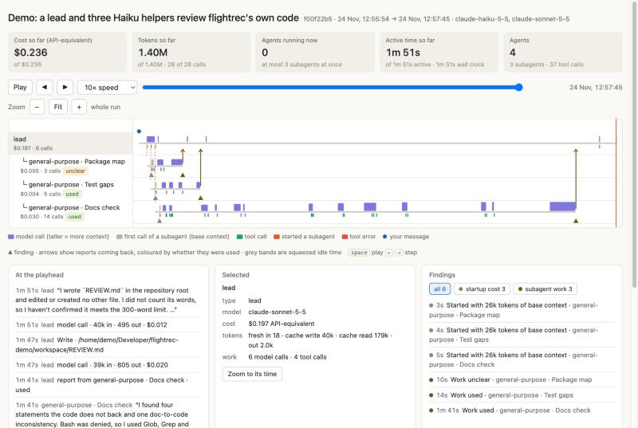

# flightrec

A local flight recorder for multi-agent Claude Code runs. It reads the transcripts Claude Code already writes on your machine and shows the lead agent and its subagents: what each was told, what each cost in tokens, time and API-equivalent dollars, what was repeated, whether each subagent's work was used, and who approved what. Any run opens as a single offline HTML page with a lane per agent and a replay.

[](https://samyakjain510.github.io/agent-flight-recorder/demo/)

[Open the demo page](https://samyakjain510.github.io/agent-flight-recorder/demo/) (a lead and three Haiku helpers reviewing this repository) · [Read the write-up](docs/write-up.md) (what it found on my own runs)

Nothing leaves your machine. flightrec has no dependencies beyond Python 3.9+ and makes no network calls.

## Install

```bash
pipx install git+https://github.com/samyakjain510/agent-flight-recorder
```

Or `python3 -m pip install --user git+https://github.com/samyakjain510/agent-flight-recorder`. To run it without installing: clone the repository and use `PYTHONPATH=src python3 -m flightrec` in place of `flightrec`.

## Use

```bash
flightrec view --all --open        # a page per multi-agent session, plus an index, opened in your browser
flightrec list                     # sessions that used subagents
flightrec show <session>           # the agent tree, with tokens and time per branch
flightrec analyze <session>        # startup cost, repeated work, where subagent work went, conflicts, approvals
flightrec study                    # the same across every multi-agent session (add --json FILE to save the numbers)
flightrec check --all              # compare token counts with Claude Code's own totals
```

`<session>` is a session id or its first few characters. flightrec reads `~/.claude/projects` (or `$CLAUDE_CONFIG_DIR/projects`); point it elsewhere with `--root`. Put `--redact` before the command to replace every piece of transcript text (titles, instructions, reports, commands, paths) with its length, for example before sharing a screenshot. Pages go to `./flightrec-view/` unless you pass `--out`.

To try it without your own transcripts, use the demo run in this repository:

```bash
flightrec --root examples/demo-run/projects view --all --open
```

## What it found on my runs

From 11 multi-agent sessions and 30 subagents on my Mac (October–November 2026). Details, method and limits are in the [write-up](docs/write-up.md).

- A subagent starts with a median of 48k tokens of base context. For jobs of 1 to 5 model calls, carrying it was a median of 56% of the subagent's cost.
- Delegating was still cheaper than the lead doing the same work in 27 of 30 cases (an estimate), because the lead's own context was larger still.
- Parallel helpers overlapped: a median of 17% of a helper's distinctive findings also appeared in a sibling's report, against 0% for unrelated reports.
- 96% to 100% of subagent spend went to work the lead used, depending on the method (text and file tracing, or a blind model judge).
- Settings made all 1,766 permission decisions in those sessions.

## How the numbers are checked

- `flightrec check` compares token counts with the totals Claude Code keeps itself. On my machine, across 43 sessions where a fair comparison is possible, flightrec never counted more and matched exactly in 17. The gap in the rest is calls Claude Code doesn't write to the transcript.
- Prices were worked out from Claude Code's own cost records: list prices reproduce them to the cent in 37 of 38 records.
- Lineage verdicts were checked against a blind model judge with controls (`scripts/judge_lineage.py`). That script sits outside the package because it sends transcript excerpts to Anthropic through `claude -p`.
- Unit tests run on every push, on Python 3.9, 3.11 and 3.13, along with every command on the demo transcripts.

Claude Code's transcript format is internal and changes often (21 versions in three months of my data). Everything flightrec knows about it lives in `src/flightrec/claude_code.py`, and record types it doesn't recognize are reported.

## Learn how it works

I built this as a learning project and wrote a short lesson at each step:

- [Lesson 0: the big picture](docs/learn/00-big-picture.md)
- [Lesson 1: reading transcripts](docs/learn/01-reading-transcripts.md)
- [Lesson 2: what a token costs, and where the work went](docs/learn/02-what-a-token-costs.md)
- [Lesson 3: the viewer](docs/learn/03-the-viewer.md)
- [Lesson 4: the study](docs/learn/04-the-study.md)
- [What went wrong](docs/what-went-wrong.md), a running log of mistakes and what changed because of each

## Development

```bash
python3 -m unittest discover -s tests
```

An editable install (`python3 -m pip install -e .`) needs pip 21.3 or newer.

flightrec is an independent project and isn't affiliated with Anthropic.

## License

MIT
